# Diagrams

How Fosfora is put together, drawn from four perspectives, then one diagram per flow the
engine runs. Each image has a light and a dark version; GitHub picks the one that matches
your theme. The source is `scripts/diagrams.py` (`uv run scripts/diagrams.py` regenerates
every pair into `docs/images/`).

The grammar is the same in every diagram: white boxes are stages, orange pills are what goes
in and what comes out, blue diamonds are gates and blue edges their outcomes, dashed boxes
are optional or dev-only, and a ring is a loop.

## Four perspectives

### By tier: what ships, what records, what never ships

Everything in the production band runs in every download and is the same code live, in
headless `--signal` and offline. The instrumentation band is compiled into every build but
inert until an env var names a file, and it only records. The dev band exists only behind
`--features analyze`; its one product that ships is the trained beat model.

<picture>
  <source media="(prefers-color-scheme: dark)" srcset="images/tiers-dark.svg">
  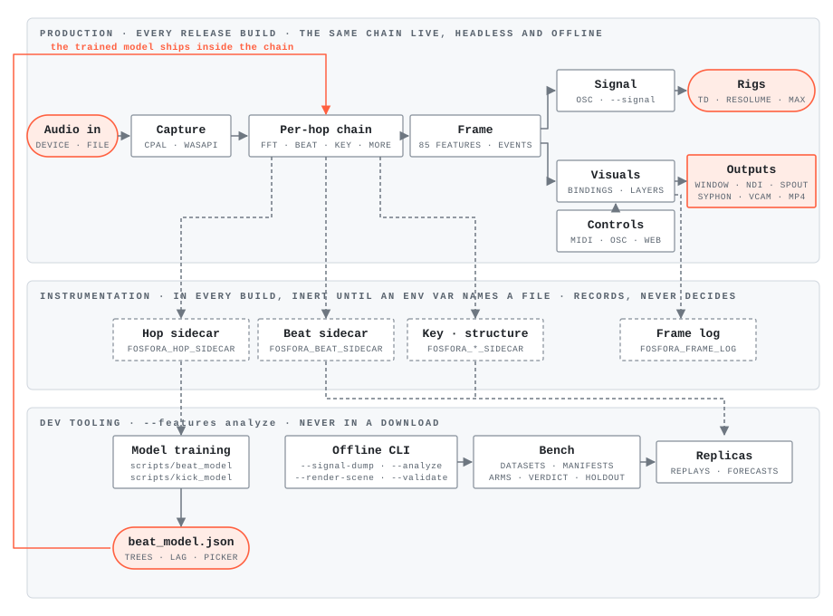
</picture>

### At runtime: threads and channels

The windowed app. Input threads feed the main thread through channels, the main thread
renders one frame per loop, and readback feeds the sink and recording threads. There is no
mutex in the hot path.

<picture>
  <source media="(prefers-color-scheme: dark)" srcset="images/runtime-dark.svg">
  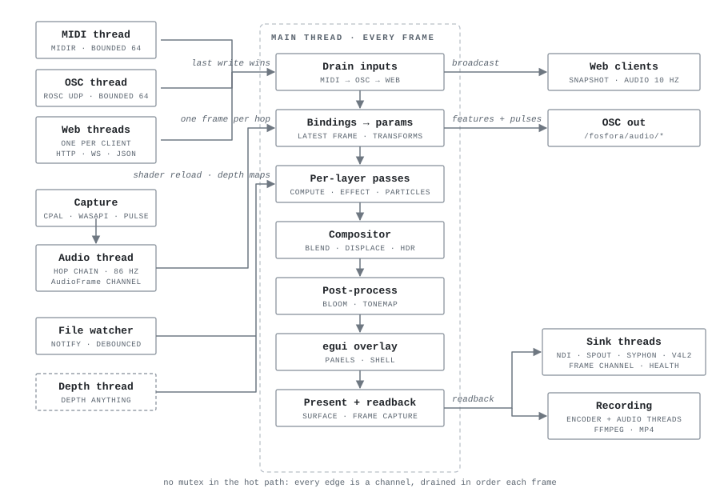
</picture>

### Data flow: in and out

The analysis has two consumers: Signal, the OSC telemetry a rig listens to, and the bindings
that drive the visuals. Controls, presets and media enter on the left; the window and the
sinks are the outputs.

<picture>
  <source media="(prefers-color-scheme: dark)" srcset="images/dataflow-dark.svg">
  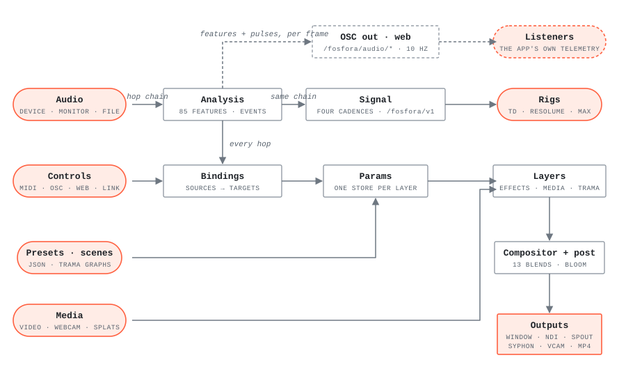
</picture>

### Builds: one crate, several feature sets

The `release` feature set is what a download ships, and that one binary is the app, the
headless `--signal` mode and `--render-loop`. `link` is opt-in and makes the binary GPL.
`analyze` adds the offline CLI the bench and CI use. The lib with no default features is
the XR frontend's base.

<picture>
  <source media="(prefers-color-scheme: dark)" srcset="images/builds-dark.svg">
  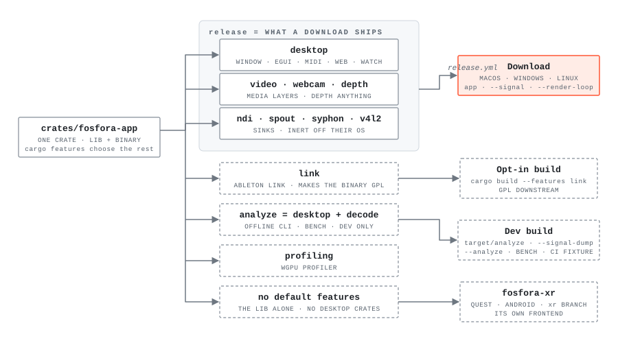
</picture>

## One diagram per flow

### The hop: 86 times a second

The per-hop chain in the order the code runs it, from the 512-sample hop to the frame of 85
features and events. The dashed taps are the sidecars.

<picture>
  <source media="(prefers-color-scheme: dark)" srcset="images/hop-dark.svg">
  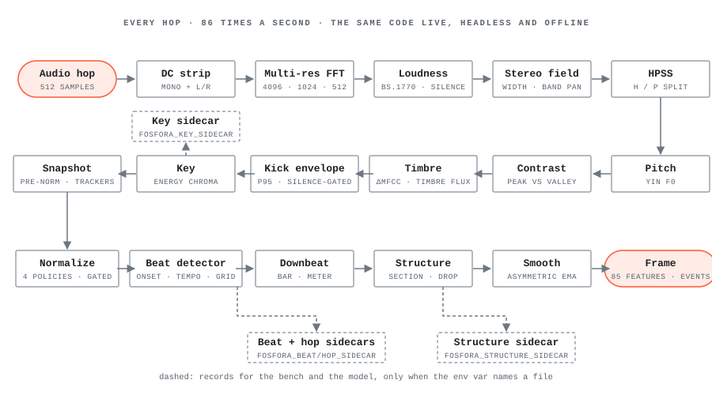
</picture>

### The beat path

The onset flux earns the tempo through the seed gate, the activation chooses the metrical
level once seeded, and the grid runs as a loop per instant: emit 10 ms early, settle, correct
the phase, fold the evidence, vote. Three votes in a row move the grid later.

<picture>
  <source media="(prefers-color-scheme: dark)" srcset="images/beat-dark.svg">
  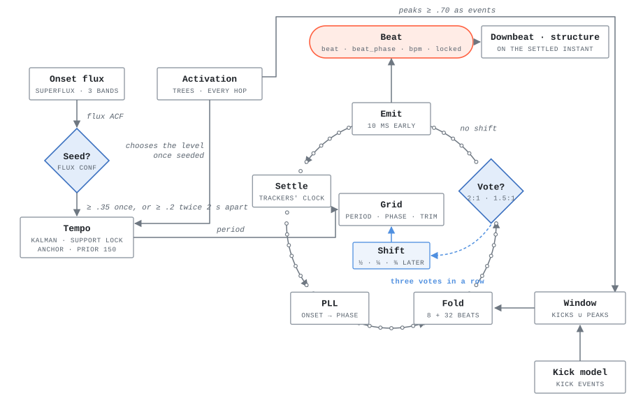
</picture>

### One frame

The main thread per frame: drain inputs, apply bindings, run every enabled layer through
compute, effect passes and particle render, composite, post-process, egui, present, read
back for the sinks.

<picture>
  <source media="(prefers-color-scheme: dark)" srcset="images/frame-dark.svg">
  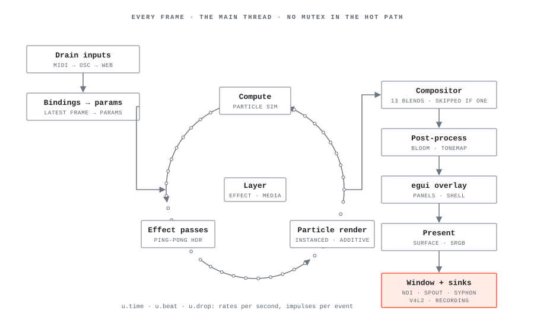
</picture>

### Signal: from a hop to an OSC packet

The four cadences of `--signal`: events the hop they are detected, continuous values at the
TX rate, on-change addresses re-broadcast at 1 Hz, and a 1 Hz status heartbeat. `--signal-dump`
is the same emitter on a file, which is what the bench scores.

<picture>
  <source media="(prefers-color-scheme: dark)" srcset="images/signal-dark.svg">
  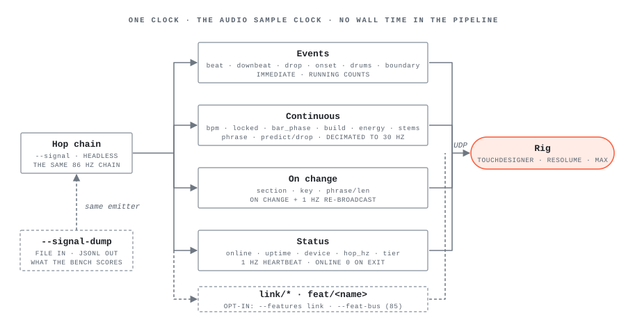
</picture>

### A bench round

The loop that ships a constant: a measured gap with its mechanism named, a frozen manifest,
an exact replica forecast, and only then arms; the tune halves decide, the holdout is read
once, and a miss is recorded rather than re-tuned.

<picture>
  <source media="(prefers-color-scheme: dark)" srcset="images/round-dark.svg">
  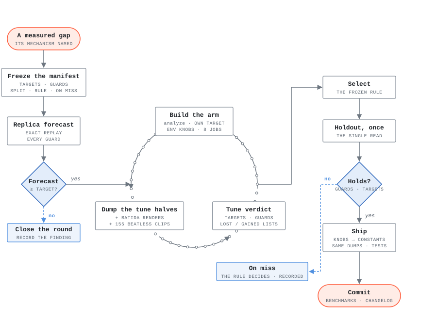
</picture>

### Training the beat activation

The model is trained on the raw evidence the detectors read, dumped per hop through the hop
sidecar, and the export is golden-tested before the runtime evaluates it every hop.

<picture>
  <source media="(prefers-color-scheme: dark)" srcset="images/model-dark.svg">
  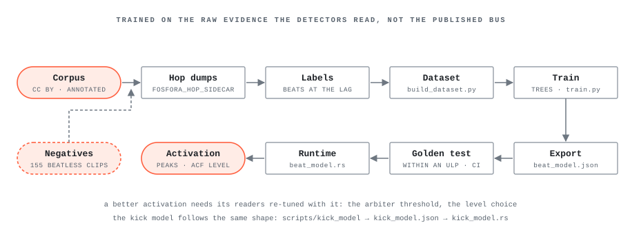
</picture>

### Offline: the same chain driven by a file

A file is decoded and run through the hop chain faster than realtime. Three of the four
outputs are dev-only; `--render-loop` ships in every download.

<picture>
  <source media="(prefers-color-scheme: dark)" srcset="images/offline-dark.svg">
  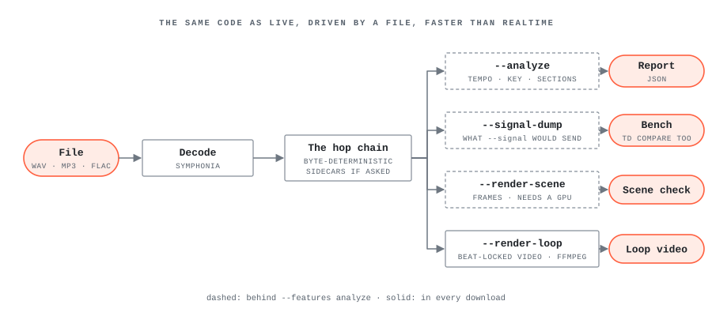
</picture>
